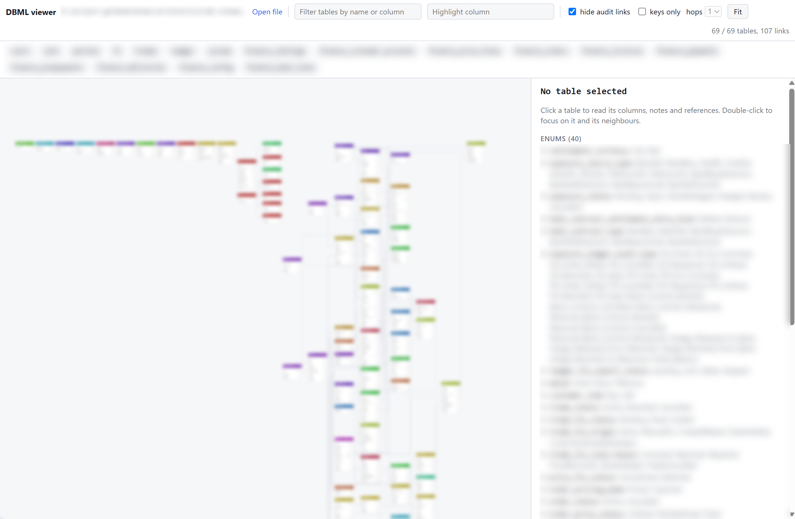

# dbdiagram-local

A local, browser-based viewer for [DBML](https://dbml.dbdiagram.io/) schema files. It is built for schemas that are too big to read as one picture: pick a table, see only its neighbours, hide the audit links that turn every diagram into a star around `users`, and read the notes next to the columns they describe.

Nothing is hosted and nothing leaves your machine. The page runs on a Vite dev server on localhost and reads the DBML file from your disk.



## Setup

You need Node.js 20 or newer.

```bash
git clone https://github.com/Eliz-Titansoft/dbdiagram-local.git
cd dbdiagram-local
npm install
```

## Run

Point the dev server at a DBML file and open the printed URL, usually http://localhost:5173.

```bash
# Git Bash, macOS, Linux
DBML_FILE=../midas/architecture/db-schema.txt npm run dev

# PowerShell
$env:DBML_FILE = "..\midas\architecture\db-schema.txt"; npm run dev
```

The page reloads the schema whenever the file is saved, so you can keep it open while editing the DBML.

Without `DBML_FILE` the page opens empty and asks for a file. Use **Open file**, or drop a `.dbml` or `.txt` file anywhere on the page. **Try the sample schema** loads a small bundled example if you only want to see the viewer work.

## Using the viewer

- **Click** a table, or Tab to it and press Enter, to read its columns, notes, indexes and references in the side panel. Links in the panel jump to the related table. Below about 900px the panel opens as a sheet over the diagram.
- **Double-click** a table, Shift+Enter on it, or press **Focus** in the panel, to show only that table and its neighbours. The focused table carries a **focus** badge. **hops** widens the neighbourhood to two or three links. The **focus** chip in the header clears it.
- **Keys**: `/` jumps to the filter, `F` or Ctrl+0 fits the diagram, `+` and `-` zoom, Escape closes the panel, then clears the focus.
- **hide audit links** is on by default. It hides every reference from a `*_by` column to the users table, such as `created_by` and `updated_by`, so the diagram shows the data model and not the audit trail.
- **keys only** draws each table with only its primary key and `*_id` columns, which keeps a wide schema readable.
- **Filter tables** keeps the tables whose name or column name contains the text. **Highlight column** marks matching columns on every table, which is the quick way to see where a column such as `customer_id` travels.
- The **group** chips under the header work like mute and solo on a mixer. Click a chip to hide that group, click again to show it. Double-click, or Alt+click, to show only that group; a plain click on another chip then adds it. **All** brings every group back. Groups come from `TableGroup` blocks in the DBML. Without them, tables are grouped by the first word of their name.
- The focus, hops, audit, keys-only, hidden-group, filter and selected-table settings are kept in the URL, so a link opens the same view for someone else.
- Links carry crow's-foot ends: a fork on a many end, a bar on a one end. So many-to-one is a fork at the child and a bar at the parent, one-to-one has a bar at both ends, many-to-many a fork at both. Hover a link, or read the panel's reference lists, for the same in words.
- Scroll or pinch to zoom, drag the background to pan, **Fit** brings the whole layout back into view. The diagram refits only when the set of shown tables changes, so toggling keys only or audit links keeps your zoom.

If the file does not parse, the header shows the line and the message from the DBML parser, and the last good schema stays on screen.

## How it works

- [`@dbml/core`](https://github.com/holistics/dbml) parses the DBML in the browser. It is the open-source parser behind dbdiagram.io.
- [`elkjs`](https://github.com/kieler/elkjs) lays the tables out as a layered graph with orthogonal edges.
- Vue 3 and Vite render the result as plain SVG. There is no canvas library and no diagram framework to learn.

Source layout:

| Path | What it holds |
|---|---|
| `src/lib/schema.ts` | DBML parsing into the viewer's own flat model |
| `src/lib/graph.ts` | Focus neighbourhood, audit-link rule, group colours |
| `src/lib/layout.ts` | The ELK layout call and card sizing |
| `src/components/SchemaCanvas.vue` | The SVG drawing, pan and zoom |
| `src/components/SidePanel.vue` | Table detail |
| `src/App.vue` | Loading, view state, the header controls |
| `vite.config.ts` | The `DBML_FILE` dev-server plugin |

## Hosted copy on GitHub Pages

The `Pages` workflow builds the viewer on every push to `main`, once a day, and on demand, and publishes it at https://eliz-titansoft.github.io/dbdiagram-local/ with the Midas schema loaded. The page is public, and so is the schema it carries.

The workflow reads `architecture/db-schema.txt` from the private Midas repo with a repository secret named `MIDAS_READ_TOKEN`: a fine-grained personal access token for the `Eliz-Titansoft` organisation with **Contents: read** on the `midas` repository and nothing else. Without the secret the site still deploys and opens empty, asking for a file.

```bash
gh secret set MIDAS_READ_TOKEN -R Eliz-Titansoft/dbdiagram-local
```

## Build

```bash
npm run build
```

`dist/` is a static page. It cannot read files from disk. It loads `schema.dbml` from beside itself when one is published there, otherwise it opens empty and asks for a file. The dev server is the intended way to run the viewer against a file you are editing.

## Notes on DBML

The parser is strict about a few things dbdiagram.io tolerates. In particular, an apostrophe inside a single-quoted note must be written `\'`, not doubled SQL-style as `''`.
